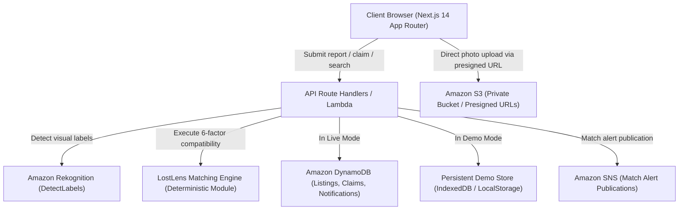

# LostLens — AI-Powered Campus Lost & Found Platform

LostLens is a modern, full-stack, AI-assisted lost-and-found recovery platform designed for universities, colleges, corporate campuses, and community centers. It automates candidate matching between lost-item and found-item reports using Amazon Rekognition visual tags, campus geography, and a deterministic 6-factor scoring engine.

---

## 🌟 Key Features

1. **Zero-Credential Demo Mode**:
   - Out of the box, the application runs fully locally on a fresh machine without requiring AWS credentials or cloud provisioning.
   - Seeded with 20+ realistic lost and found reports, positive/negative candidate pairs, and recovery histories.
   - State changes (creating reports, claims, verifications, status updates) persist locally in browser storage and survive page reloads.
   - Built-in "Reset Demo" action restores the seed dataset instantly.

2. **Deterministic Matching Engine**:
   - 6-factor weighted algorithm calculating normalized compatibility scores (0–100):
     - **35%**: Visual label overlap from Amazon Rekognition
     - **20%**: Item category compatibility
     - **15%**: Color alignment
     - **15%**: Campus zone and building proximity
     - **10%**: Temporal proximity (chronological validity)
     - **5%**: Description keyword overlap
   - Human-readable narrative explanation generated for every suggested match with supporting clues and conflicting evidence.

3. **Amazon Rekognition Visual Label Extraction**:
   - Automatically detects item tags (e.g. *Backpack, Canvas, Bottle, Headphones, Footwear*) with confidence ratings.
   - Simulated Rekognition responses in Demo Mode are explicitly tagged to preserve transparency.

4. **Confidential Claim & Verification Workflow**:
   - Private ownership verification clues (e.g., engravings, secret badges, serial numbers) remain strictly hidden from the public view.
   - Claimants submit private distinguishing proof; item finders review, approve, or reject claims with decision notes.
   - Verified claims transition listings to `resolved` and generate in-app notifications.

5. **Operational Analytics & Trend Visualizations**:
   - Interactive charts powered by Recharts tracking submission trajectories, category frequencies, recovery rates, and time-to-recovery velocity.

---

## 🏗️ Architecture



---

## 🛠️ Technology Stack

- **Framework**: Next.js 14 (App Router)
- **Language**: TypeScript (Strict type checking)
- **Styling**: Tailwind CSS with custom design system tokens
- **Icons**: Lucide React
- **Data Visualizations**: Recharts
- **Validation**: Zod schemas
- **Cloud SDK**: AWS SDK for JavaScript v3 (`@aws-sdk/client-s3`, `@aws-sdk/client-rekognition`, `@aws-sdk/client-dynamodb`, `@aws-sdk/client-sns`, `@aws-sdk/s3-request-presigner`)
- **Testing**: Vitest + Testing Library + jsdom

---

## 📂 Project Structure

```
cloud_Project/
├── src/
│   ├── app/
│   │   ├── layout.tsx                # App shell with responsive sidebar & header
│   │   ├── globals.css               # Warm off-white & indigo design tokens
│   │   ├── page.tsx                  # Landing page with interactive match demonstration
│   │   ├── dashboard/page.tsx        # Overview dashboard with KPIs & trend chart
│   │   ├── explore/page.tsx          # Filterable listing explorer
│   │   ├── report/page.tsx           # Report lost/found item with photo upload
│   │   ├── matches/page.tsx          # Smart Matches workspace with inspector
│   │   ├── listings/[id]/page.tsx    # Listing details, Rekognition tags & claims
│   │   ├── my-reports/page.tsx       # Personal lost/found management
│   │   ├── analytics/page.tsx        # Visual recovery analytics & metrics
│   │   └── api/                      # Next.js API route handlers
│   ├── components/
│   │   ├── shell/                    # AppHeader, AppSidebar, DemoBadge, NotificationDropdown, UserMenu
│   │   ├── ui/                       # Button, Badge, Card, Modal, Input, Skeleton
│   │   ├── listings/                 # ListingCard, ListingGrid, ListingFilters, ListingStatusBadge
│   │   ├── matches/                  # MatchComparisonCard, MatchBreakdownModal, ScoreIndicator
│   │   ├── claims/                   # ClaimModal, ClaimReviewCard
│   │   └── visualizations/           # ActivityTrendChart, CategoryDistributionChart
│   ├── lib/
│   │   ├── matching/                 # engine.ts, weights.ts, explain.ts
│   │   ├── aws/                      # config.ts, s3.ts, rekognition.ts, dynamodb.ts, sns.ts
│   │   ├── demo/                     # seedData.ts, store.ts, simulatedRekognition.ts
│   │   ├── types/                    # listing.ts, match.ts, claim.ts, notification.ts, user.ts
│   │   ├── validation/               # schemas.ts (Zod validation)
│   │   └── utils/                    # formatters.ts, cn.ts
│   └── test/                         # matching.test.ts, demoStore.test.ts, schemas.test.ts
├── AWS_SETUP.md                      # Complete cloud provisioning & IAM guide
├── package.json
├── tsconfig.json
├── tailwind.config.ts
└── vitest.config.ts
```

---

## 🚀 Getting Started

### 1. Installation
Clone the repository and install dependencies:
```bash
git clone <REPO_URL>
cd cloud_Project
npm install
```

### 2. Running in Demo Mode (Default)
Start the local Next.js development server:
```bash
npm run dev
```
Open [http://localhost:3000](http://localhost:3000) in your browser. All features work immediately without cloud credentials.

### 3. Running Unit Tests
Execute the Vitest test suite:
```bash
npm test
```

### 4. TypeScript Type Checking
```bash
npm run typecheck
```

### 5. Production Build
```bash
npm run build
npm start
```

---

## ☁️ Live AWS Mode Setup

To connect to genuine AWS resources:
1. Refer to the step-by-step instructions in [`AWS_SETUP.md`](./AWS_SETUP.md).
2. Configure `.env.local` using `.env.example` as a template:
   - Set `NEXT_PUBLIC_APP_MODE=live`
   - Supply `AWS_REGION`, `AWS_ACCESS_KEY_ID`, `AWS_SECRET_ACCESS_KEY`
   - Configure S3 bucket, DynamoDB tables, and SNS Topic ARN.
3. Restart the application. The Demo Mode indicator will update to Live AWS Mode.

---

## 🔒 Security & Privacy Practices

- **Zero Client Credential Exposure**: No AWS credentials or secret keys are bundled in client JavaScript.
- **Private S3 Storage**: Object photographs are uploaded directly to private S3 buckets using short-lived server-generated presigned URLs.
- **Protected Ownership Details**: Secret verification clues and claimant distinguishing details are protected by role-based filtering and are never exposed publicly.
- **Input Sanitization**: Untrusted payloads are validated using strict Zod schemas.

---

## 📄 License
MIT License.
